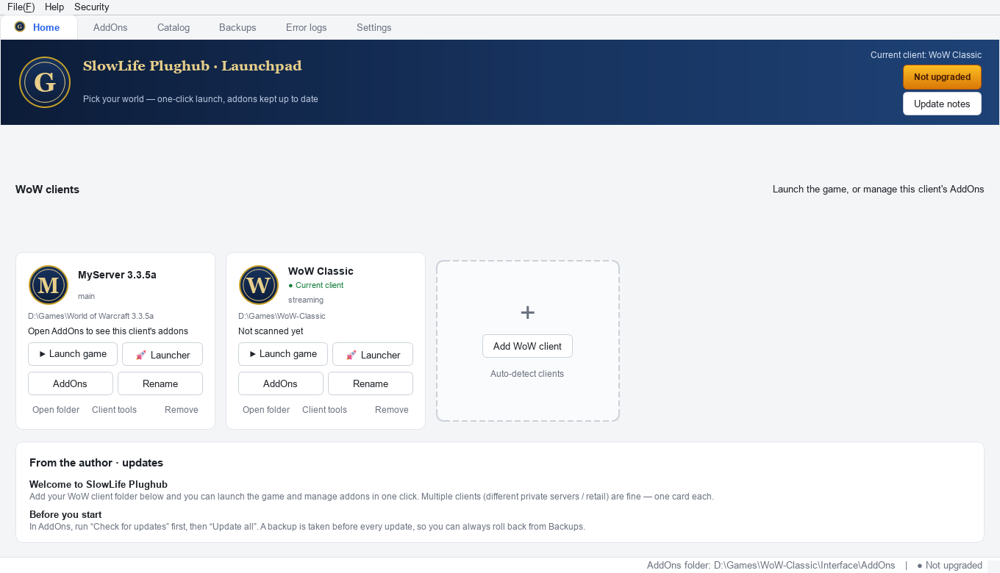
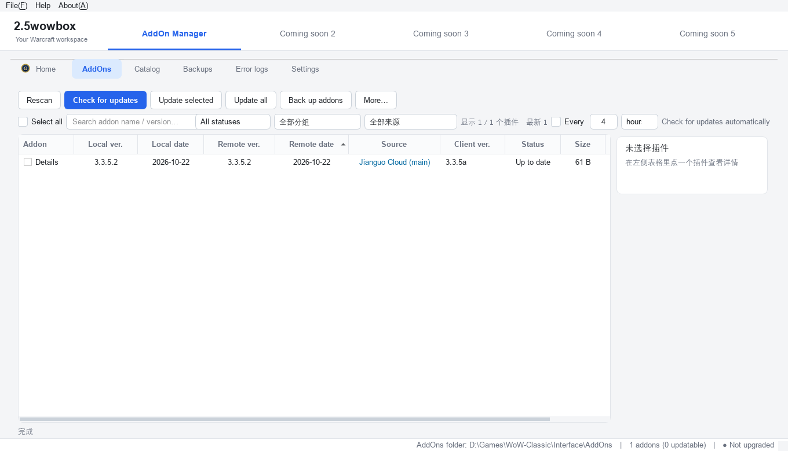
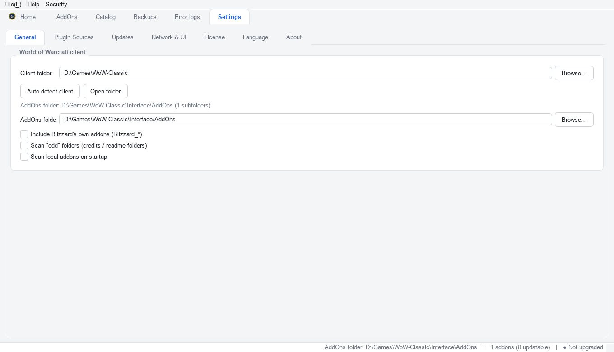
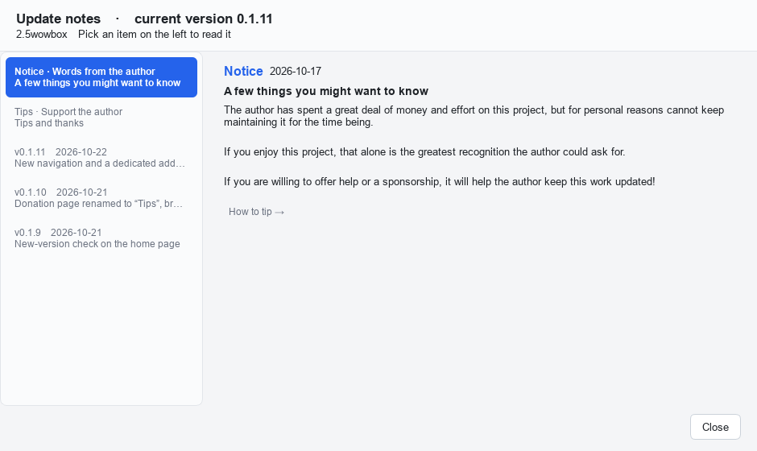

[**简体中文**](README.md)　|　**English**

# 2.5wowbox Addon Manager

**A general-purpose addon manager for World of Warcraft private servers — any patch, any server**

One-click updates · automatic backups · instant rollback · error logs explained in plain language

[**Download latest**](../../releases/latest)　·　[User guide (Chinese)](https://docs.qq.com/sheet/DSHZRZUJ2V2pkQ050?tab=BB08J2)　·　[Report an issue](mailto:kyomunehiro@gmail.com)

---

> **This repository (`2.5WoWBox`) is the sole official distribution channel for 2.5wowbox.**
>   
> The application is called **2.5wowbox Addon Manager**, and **English release files are named
>   
> `2.5wowbox-*`** (e.g. `2.5wowbox-0.1.10.exe`) to match, so you can tell at a glance that what you
>   
> downloaded is an official build.
>   
> It used to be called `SlowLife PlugHub`; renamed to 2.5wowbox in Oct 2026 — **do not download the
>   
> old file names.**
>
> This is the distribution page for a closed-source application. No source code is included.
>   
> What you'll find here: documentation, release notes, and the installer packages of each version (Releases).

---

## What is this

Anyone playing on a private server runs into the same three problems:

- Addons are scattered across a dozen sites and cloud drives, and you never know which one has a newer build;
- Replacing files by hand is error-prone — one wrong folder and the game throws errors, and last week's working setup is gone;
- On login you get a wall of red `Interface\AddOns\xxx\yyy.lua:123: attempt to ...` messages you can't read.

**2.5wowbox Addon Manager** puts all three in one window: it scans your local `Interface/AddOns`,
  
connects to **your own** addon sources (WebDAV / cloud links / share links / JSON catalogs / GitHub / local folders),
  
compares versions, updates in one click, backs up before every overwrite, and rolls back whenever something breaks.

**It is a manager, not a repack ("integration pack").** Which addons you install, and whose build you use, is entirely up to you.

---

## Features

| Feature                         | What it does                                                                                                                               |
| ------------------------------- | ------------------------------------------------------------------------------------------------------------------------------------------ |
| **Local scan**                  | Reads addon name, version and client interface version (`3.3.5a`, `1.15.x`, Classic, …), and spots disabled addons                         |
| **Multiple clients**            | One card per private server — each with its own addon folder, no cross-contamination. Renameable at any time                               |
| **Multiple sources**            | WebDAV, direct cloud links, share links, JSON catalogs, GitHub, local folders — several at once                                            |
| **One-click update**            | Compares **version *and* release date** (not a naive string compare); addons sharing a name but coming from different sources are labelled |
| **Automatic backup / rollback** | Every overwrite is snapshotted; roll back to any point before any update                                                                   |
| **Download diff**               | Lists added / changed / missing files *before* applying an update                                                                          |
| **Error-log analysis**          | Scans `Logs`, `Errors` and `SavedVariables`, turns Blizzard's error blocks into readable explanations with suggestions                     |
| **Launcher support**            | Remember each server's own launcher, or launch the game directly                                                                           |
| **Client tools**                | Font replacement, patch management, personal settings import/export                                                                        |
| **Chinese & English UI**        | The interface language is suggested from your system language, and can be changed later in Settings                                        |

---

## Screenshots

<table>
  
<tr>
  
<td width="50%"></td>
  
<td width="50%"></td>
  
</tr>
  
<tr>
  
<td align="center">Addon list: version, source and status at a glance</td>
  
<td align="center">Settings: client folder, scan rules, updates and network</td>
  
</tr>
  
</table>

The `D://Games//…` paths in the screenshots are examples, not real folders.

---

## Download & install

Grab the archive you need from [**Releases**](../../releases/latest). Unzip and run —
  
**no installer, no registry entries.**

**Use the `2.5wowbox-*` files below** — those are the English-named builds.
  
(There are also Chinese-named `.rar` packages in the same release, for Chinese users; they contain
  
exactly the same program.)

| Package                                               | Best for                                       | Notes                                                                                                                                         |
| ----------------------------------------------------- | ---------------------------------------------- | --------------------------------------------------------------------------------------------------------------------------------------------- |
| `2.5wowbox-0.1.10.exe` — **single file**              | Most users                                     | One `.exe`; smallest and easiest to copy around                                                                                               |
| `2.5wowbox-0.1.10-portable.zip` — **portable folder** | Anyone worried about antivirus false positives | Unzip and run; starts faster and has **noticeably fewer AV false positives**. It is a `.zip`, so Windows opens it natively — no WinRAR needed |

**First run, in three steps:**

1. Unzip anywhere **except** `Program Files` (no write permission there by default);
2. Double-click `2.5wowbox魔兽插件管理器.exe`;
3. On first launch you'll be asked whether you want Chinese or English — then just follow the on-screen guide to add your client folder.

**Where data lives:** a `SlowLifeData/` folder next to the executable (config, cache, backups and logs all live there).

> Want to carry it on a USB stick? Copy the folder **together with** `SlowLifeData/` — that's the complete portable setup.

---

## About "activation"

This deserves a clear explanation, because it's the easiest thing to misunderstand:

- **There is no functional difference between activated and non-activated usage.**
    
  Update checking, backup/rollback and error analysis all work fully without activation.
- Activation only unlocks **two or three experimental settings the developer uses** — normal players won't notice a difference.
- The software contains **no paid content whatsoever**. The licence key exists for exactly one reason:
    
  **to stop people from repackaging it and selling it.**
- Licensing is **offline**: it's a local text file (`.glic`) that you can open, inspect and delete.
    
  Delete it and you're back to the non-activated state.

> **Beware of scams:** anyone who contacts you offering to "activate it for you", "guarantee it works"
>   
> or sell you an "internal channel" is a scammer. Please don't send money.

---

## Security

People reasonably ask: "a program that wants a licence key — what is it doing behind my back?"
  
So here are the facts.

**The only thing it actually does:**

- Verifies, with an **Ed25519 digital signature**, that an **offline licence file** was issued by the author;
- That licence is a plain local text file next to the program — you can open it, read it, and delete it at any time;
- The signing scheme is a standard implementation in the Python ecosystem, and the in-app "Security audit report" is available for self-checking.

**What it does *not* do (not a single one):**

- It does not collect or upload any data (**no telemetry, no analytics, no ad SDK**);
- It does not change system settings, add startup entries, install services, or stay resident in the background;
- It does not encrypt any of your files and never touches your documents, photos or game data;
- It does not execute anything downloaded from the internet through the command line.

You can re-read this any time under **Security → Security statement** in the app.

---

## Requirements

| Item       | Requirement                                                                             |
| ---------- | --------------------------------------------------------------------------------------- |
| OS         | Windows 10 / 11 (64-bit)                                                                |
| Game       | Any WoW client / private server (3.3.5a, 1.12, Classic, …)                              |
| Privileges | Standard user — **administrator is not required**                                       |
| Network    | Only "check for updates / fetch catalog" needs a connection; everything else is offline |

---

## FAQ

<b>My antivirus flags it — what now?</b>

Windows programs packaged with PyInstaller are commonly false-positived, because the way they bootstrap
  
resembles some malware. Add the program folder to your antivirus / Defender allow-list.
  
**The unpacked-folder build has a much lower false-positive rate** than the single-EXE build — pick it if that worries you.

<b>How do I move my setup to another PC?</b>

Copy the whole folder, including `SlowLifeData/`. Everything is local files; nothing is bound to an account.

<b>How do I uninstall it completely?</b>

Just delete the program folder. It writes no registry entries, installs no services and leaves no background process —
  
deleting the folder is a clean uninstall. If your antivirus is holding a file, reboot and delete again.

<b>An addon update broke the game — how do I go back?</b>

Open the **Backups** page, find the snapshot taken before that update, and hit rollback.
  
A backup is created automatically before every overwrite.

<b>Can it manage "integration packs" (整合包)?</b>

It can recognise addons inside them, but it deliberately does **not** offer "install a whole pack in one click":
  
packs usually contain a lot you don't need and tend to conflict with each other.
  
Managing *your own* selection is what this tool is for.

<b>macOS / Linux support?</b>

Only Windows builds are published at the moment.

---

## Supporting the author

This tool was written bit by bit in the author's spare time. If it's useful to you,
  
**a silent thumbs-up is more than enough** — the program only goes online to check for updates,
  
so the author won't see your praise anyway.

If you really want to give something back, email **<kyomunehiro@gmail.com>** (sponsorship details are answered there).

---

## License & disclaimer

- **Closed source.** This repository publishes compiled builds and documentation only; **no source code is provided.**
  Copyright © Delete, All Rights Reserved.
- **Sole distribution channel.** Apart from this repository's Releases, the author has authorised no third party
  (including marketplaces such as Xianyu or Taobao) to distribute this software. If you **paid** for it somewhere else,
  request a refund immediately — someone is reselling free software.
- **No redistribution of modified builds.** Any build that is repackaged, or whose in-app text or donation details
  have been altered, is not published by the author — the author is not responsible for its content or safety.
- **Not affiliated with Blizzard.** *World of Warcraft* is a trademark of Blizzard Entertainment.
  This is an unofficial third-party tool with no affiliation or partnership with Blizzard Entertainment.
- **Use at your own risk.** Addons come from sources you configure yourself; the author is not responsible for
  third-party addon content or stability. Any damage or data loss caused by modifying this program is your own responsibility.

The full terms (what you may / may not do, plus the warranty disclaimer) are in **[LICENSE.md](LICENSE.md)**.

---

中文读者 → **[README.md](README.md)**

