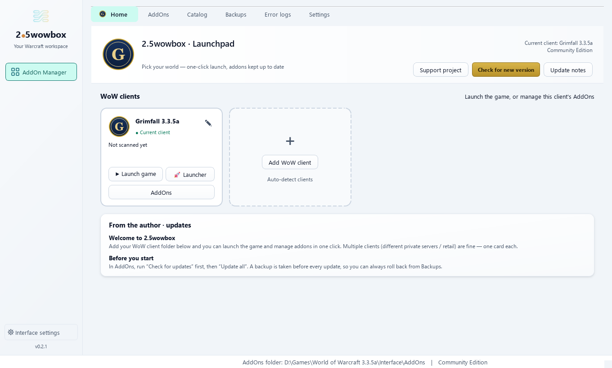
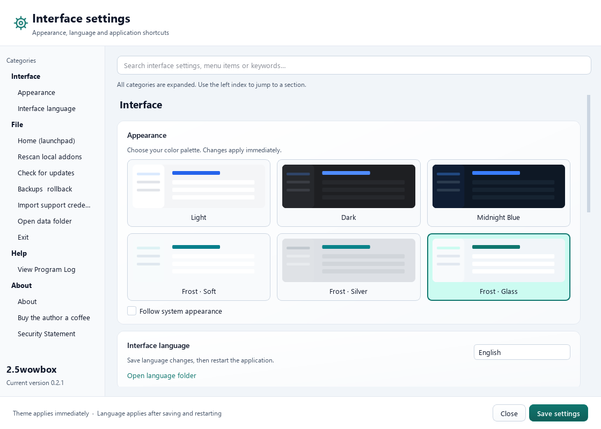
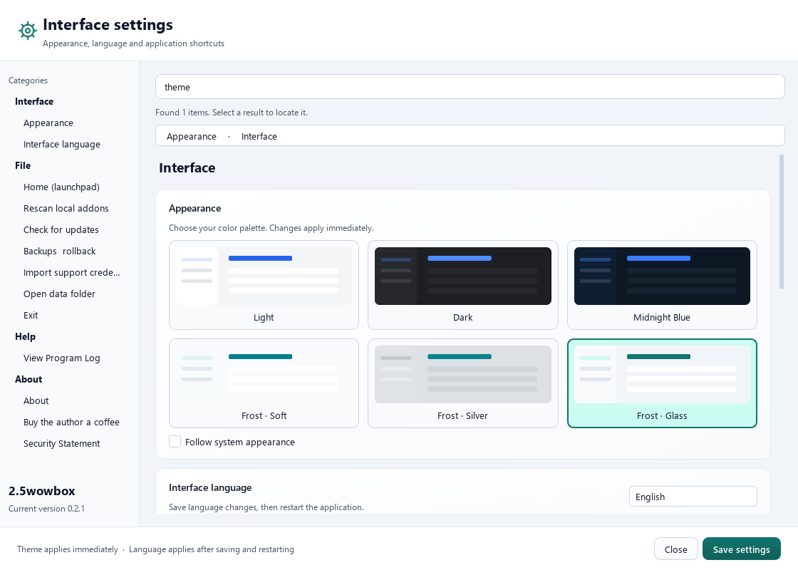
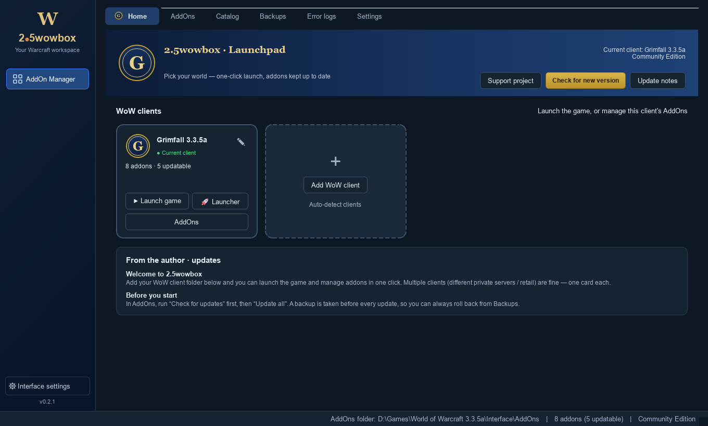
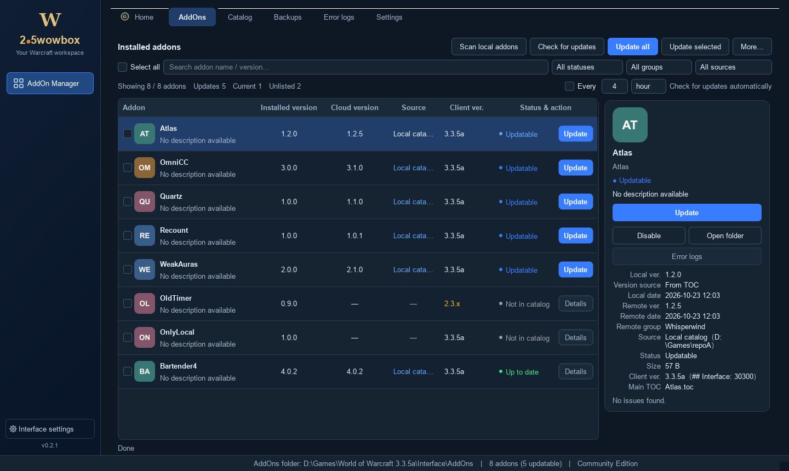
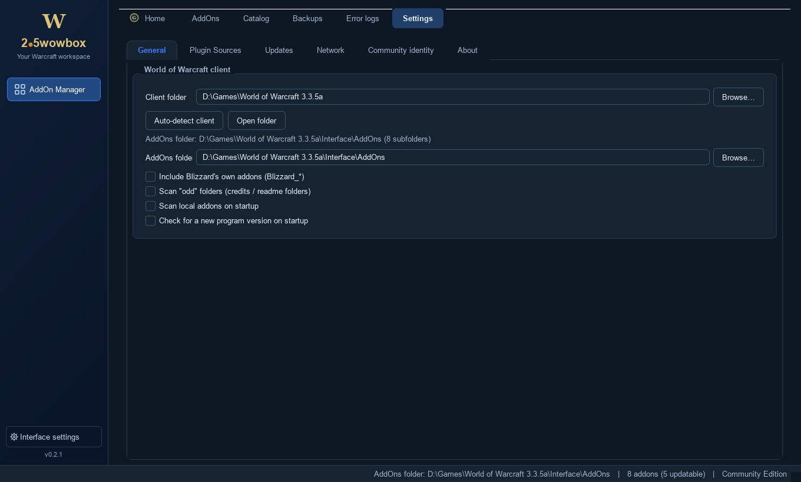
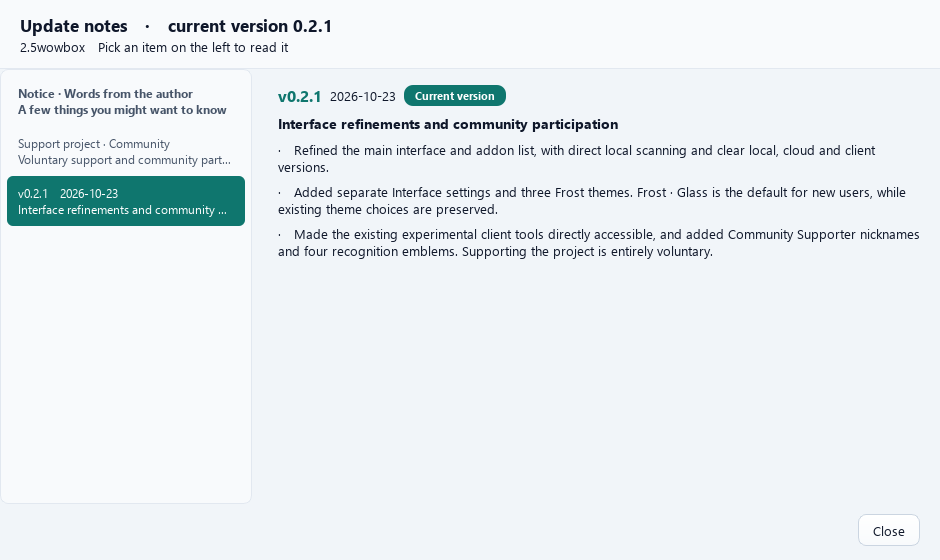

[**简体中文**](README.md)　|　**English**

# 2.5wowbox Addon Manager

**A general-purpose addon manager for World of Warcraft private servers — any patch, any server**

One-click updates · automatic backups · instant rollback · error logs explained in plain language

[**Download latest**](../../releases/latest)　·　[User guide (Chinese)](https://docs.qq.com/sheet/DSHZRZUJ2V2pkQ050?tab=BB08J2)　·　[Report an issue](mailto:kyomunehiro@gmail.com)

---

> **This repository (`2.5WoWBox`) is the sole official distribution channel for 2.5wowbox.**
>   
> The application is called **2.5wowbox Addon Manager**, and **English release files are named
>   
> `2.5wowbox-*`** (e.g. `2.5wowbox-0.1.10.exe`) to match, so you can tell at a glance that what you
>   
> downloaded is an official build.
>   
> It used to be called `SlowLife PlugHub`; renamed to 2.5wowbox in Oct 2026 — **do not download the
>   
> old file names.**
>
> This is the distribution page for a closed-source application. No source code is included.
>   
> What you'll find here: documentation, release notes, and the installer packages of each version (Releases).

---

## What is this

Anyone playing on a private server runs into the same three problems:

- Addons are scattered across a dozen sites and cloud drives, and you never know which one has a newer build;
- Replacing files by hand is error-prone — one wrong folder and the game throws errors, and last week's working setup is gone;
- On login you get a wall of red `Interface\AddOns\xxx\yyy.lua:123: attempt to ...` messages you can't read.

**2.5wowbox Addon Manager** puts all three in one window: it scans your local `Interface/AddOns`,
  
connects to **your own** addon sources (WebDAV / cloud links / share links / JSON catalogs / GitHub / local folders),
  
compares versions, updates in one click, backs up before every overwrite, and rolls back whenever something breaks.

**It is a manager, not a repack ("integration pack").** Which addons you install, and whose build you use, is entirely up to you.

### 0.2.1: Interface refresh and new themes

1. Refined the main interface and addon list, with direct local scanning and clear local, cloud and client versions.
2. Added separate Interface settings and three Frost themes. Frost · Glass is the default for new users, while existing theme choices are preserved.
3. Made the existing experimental client tools directly accessible, and added Community Supporter nicknames and four recognition emblems. Supporting the project is entirely voluntary.

Version 0.2.1 and these release notes are approved for local acceptance packaging; this version is not yet published. The following section explains the interface.

The sidebar provides the primary navigation. AddOn Manager contains Home, AddOns, Catalog,
Backups, Error logs and Settings. The other four slots stay blank, without icons, labels or tooltips,
until a feature is registered. Narrow windows use a compact icon rail.

The sidebar's Interface settings button opens a separate window. Appearance, language, File,
Help and About share one continuous page with scrolling, a category index and search navigation.
Shortcuts such as F5 and Ctrl+R remain available.

Light, Dark, Midnight Blue, three Frost variants and Follow system are supported. All three Frost
variants share the flowing ice-blue to pale-gold Kun mark. Without a saved or automatically migrated
theme preference, the default is Frost · Glass; existing theme choices are preserved.
Theme changes apply and save immediately. Language changes apply after saving and restarting;
Chinese, English and custom language packs remain supported.

On Windows 11 22H2+ with Qt 6.9+, native Desktop Acrylic can blur the desktop and windows behind
the app. Windows may use opaque surfaces when transparency is disabled, the window is inactive
or power saving applies. Unsupported platforms also use opaque surfaces.

The plugin workspace's Settings page keeps its original categories: General, Plugin Sources,
Updates, Network, Community identity and About. Appearance and language are in the separate Interface
settings window; plugin configuration remains in its original location.

Client and Add client cards have matching default sizes. Hover or keyboard focus expands paths,
notes and secondary actions. The pencil beside the client name renames it, while game launch
and addon management remain visible.

---

## Features

| Feature                         | What it does                                                                                                                               |
| ------------------------------- | ------------------------------------------------------------------------------------------------------------------------------------------ |
| **Local scan**                  | Reads addon name, version and client interface version (`3.3.5a`, `1.15.x`, Classic, …), and spots disabled addons                         |
| **Multiple clients**            | One card per private server — each with its own addon folder, no cross-contamination. Renameable at any time                               |
| **Multiple sources**            | WebDAV, direct cloud links, share links, JSON catalogs, GitHub, local folders — several at once                                            |
| **One-click update**            | Compares **version *and* release date** (not a naive string compare); addons sharing a name but coming from different sources are labelled |
| **Automatic backup / rollback** | Every overwrite is snapshotted; roll back to any point before any update                                                                   |
| **Download diff**               | Lists added / changed / missing files *before* applying an update                                                                          |
| **Error-log analysis**          | Scans `Logs`, `Errors` and `SavedVariables`, turns Blizzard's error blocks into readable explanations with suggestions                     |
| **Launcher support**            | Remember each server's own launcher, or launch the game directly                                                                           |
| **Client tools**                | Font replacement, patch management, personal settings import/export                                                                        |
| **Chinese & English UI**        | The interface language is suggested from your system language, and can be changed later in Settings                                        |

---

## Screenshots · 0.2.1

### Addon management

The current list combines an initials tile, addon name and description, with separate installed,
cloud and client version columns. Scan local addons is directly available in the toolbar. Each row
provides individual actions, while the detail panel collects descriptions, sources, dates and secondary actions.
The wider default window fits the available screen. Narrow windows hide the source column and combine
labelled local and cloud versions into two lines while retaining the client version. More retains backups
and optional detailed columns.

### Plugin settings

Client folders, scan rules, sources, updates and network options remain in the plugin workspace's Settings page.

### Current update notes

The update window shows only the three highlights for the current 0.2.1 version. The author's notice
and support entry remain separate.

All images are actual 0.2.1 Qt interfaces using isolated local demo data. Paths such as D:\Games
are examples. These offscreen captures illustrate layout, not live desktop-compositor blur.

---

## Download & install

Grab the archive you need from [**Releases**](../../releases/latest). Unzip and run —
  
**no installer, no registry entries.**

**Use the `2.5wowbox-*` files below** — those are the English-named builds.
  
(There are also Chinese-named `.rar` packages in the same release, for Chinese users; they contain
  
exactly the same program.)

| Package                                               | Best for                                       | Notes                                                                                                                                         |
| ----------------------------------------------------- | ---------------------------------------------- | --------------------------------------------------------------------------------------------------------------------------------------------- |
| `2.5wowbox-0.1.10.exe` — **single file**              | Most users                                     | One `.exe`; smallest and easiest to copy around                                                                                               |
| `2.5wowbox-0.1.10-portable.zip` — **portable folder** | Anyone worried about antivirus false positives | Unzip and run; starts faster and has **noticeably fewer AV false positives**. It is a `.zip`, so Windows opens it natively — no WinRAR needed |

**First run, in three steps:**

1. Unzip anywhere **except** `Program Files` (no write permission there by default);
2. Double-click `2.5wowbox魔兽插件管理器.exe`;
3. On first launch you'll be asked whether you want Chinese or English — then just follow the on-screen guide to add your client folder.

**Where data lives:** a `SlowLifeData/` folder next to the executable (config, cache, backups and logs all live there).

> Want to carry it on a USB stick? Copy the folder **together with** `SlowLifeData/` — that's the complete portable setup.

---

## Community identity and voluntary support

- All features are free, including addons, fonts, patches and personal configuration tools. No credential is required.
- The default identity is Community Edition. Importing an issuer-signed support credential displays Community Supporter · Nickname. Contributions, translations and testing can also be recognized; an identity is not proof of payment.
- Emblems are a moon for 30 days, a shaded hemisphere for 180 days, a globe for 365 days and a sun for long-term recognition. On expiry only the emblem turns grey: identity and all features remain. There are no automatic renewal prompts. A new credential replaces the nickname and emblem.
- Support is voluntary. Feedback, shared experience, translations and development contributions are welcome. The home message can be dismissed and support remains accessible manually.

Check the software source, payment recipient and service details. Contact the author if you are unsure about a third-party charge.

## Credentials and data

The `.glic` text file lives in the application data directory. Ed25519 signature, product and device checks run offline. A signature is not encryption: the recipient can read the nickname and notes. A device change may require reissuing the credential. Removing it removes the local identity display while keeping all features available.

Legacy self-renewed files are retained; displaying a supporter identity requires the original issuer-signed credential. Scanning reads addons; updates, restores and client tools write to the game folder when requested, so keep backups. Program information is available under Interface settings → About → Security statement.

---

## Requirements

| Item       | Requirement                                                                             |
| ---------- | --------------------------------------------------------------------------------------- |
| OS         | Windows 10 / 11 (64-bit)                                                                |
| Game       | Any WoW client / private server (3.3.5a, 1.12, Classic, …)                              |
| Privileges | Standard user — **administrator is not required**                                       |
| Network    | Only "check for updates / fetch catalog" needs a connection; everything else is offline |

---

## FAQ

<b>My antivirus flags it — what now?</b>

Windows programs packaged with PyInstaller are commonly false-positived, because the way they bootstrap
  
resembles some malware. Add the program folder to your antivirus / Defender allow-list.
  
**The unpacked-folder build has a much lower false-positive rate** than the single-EXE build — pick it if that worries you.

<b>How do I move my setup to another PC?</b>

Copy the whole folder, including `SlowLifeData/`. Everything is local files; nothing is bound to an account.

<b>How do I uninstall it completely?</b>

Just delete the program folder. It writes no registry entries, installs no services and leaves no background process —
  
deleting the folder is a clean uninstall. If your antivirus is holding a file, reboot and delete again.

<b>An addon update broke the game — how do I go back?</b>

Open the **Backups** page, find the snapshot taken before that update, and hit rollback.
  
A backup is created automatically before every overwrite.

<b>Can it manage "integration packs" (整合包)?</b>

It can recognise addons inside them, but it deliberately does **not** offer "install a whole pack in one click":
  
packs usually contain a lot you don't need and tend to conflict with each other.
  
Managing *your own* selection is what this tool is for.

<b>macOS / Linux support?</b>

Only Windows builds are published at the moment.

---

## Supporting the author

This tool was written bit by bit in the author's spare time. If it's useful to you,
  
**a silent thumbs-up is more than enough** — the program only goes online to check for updates,
  
so the author won't see your praise anyway.

If you really want to give something back, email **<kyomunehiro@gmail.com>** (sponsorship details are answered there).

---

## License & disclaimer

- **Closed source.** This repository publishes compiled builds and documentation only; **no source code is provided.**
  Copyright © Delete, All Rights Reserved.
- **Sole distribution channel.** Apart from this repository's Releases, the author has authorised no third party
  (including marketplaces such as Xianyu or Taobao) to distribute this software. If you **paid** for it somewhere else,
  request a refund immediately — someone is reselling free software.
- **No redistribution of modified builds.** Any build that is repackaged, or whose in-app text or donation details
  have been altered, is not published by the author — the author is not responsible for its content or safety.
- **Not affiliated with Blizzard.** *World of Warcraft* is a trademark of Blizzard Entertainment.
  This is an unofficial third-party tool with no affiliation or partnership with Blizzard Entertainment.
- **Use at your own risk.** Addons come from sources you configure yourself; the author is not responsible for
  third-party addon content or stability. Any damage or data loss caused by modifying this program is your own responsibility.

The full terms (what you may / may not do, plus the warranty disclaimer) are in **[LICENSE.md](LICENSE.md)**.

---

中文读者 → **[README.md](README.md)**

