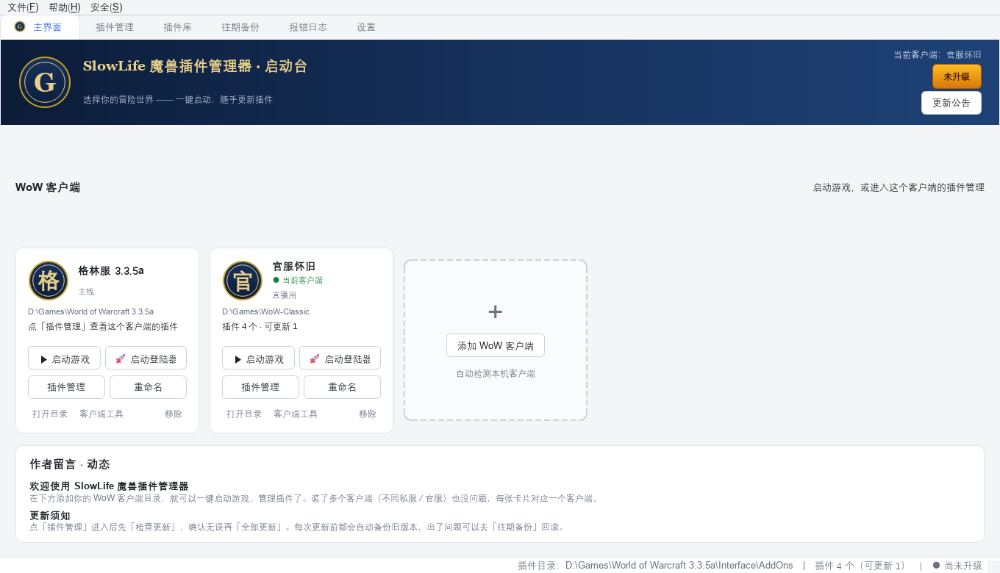
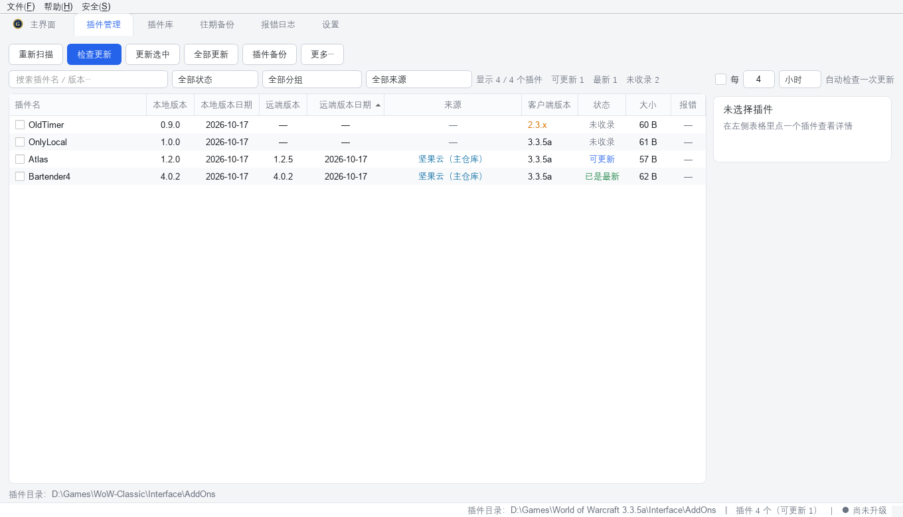
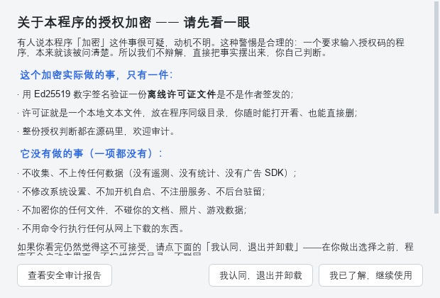
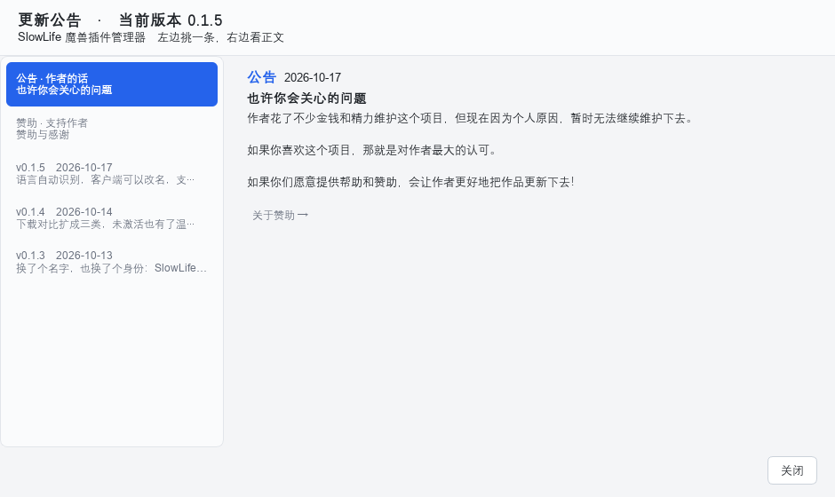

**简体中文**　|　[**English**](README.en.md)

# SlowLife 魔兽插件管理器

**面向各种 WoW 私服的通用插件管理器 —— 不限版本、不限服务器**

一键检查更新 · 自动留存旧版本 · 随时回滚 · 报错日志翻译成人话

[**下载最新版**](../../releases/latest)　·　[使用指南](https://docs.qq.com/sheet/DSHZRZUJ2V2pkQ050?tab=BB08J2)　·　[反馈问题](mailto:kyomunehiro@gmail.com)

---

> **本仓库是闭源软件的发布页，不包含源代码。**
> 这里放：使用说明、更新内容、以及每个版本的安装包（Releases）。

---

## 这是什么

玩私服的人都遇到过这些麻烦：

- 插件散在十几个网站和网盘里，不知道哪个有新版本；
- 手动替换文件，换错了插件直接报错，还找不回上一天能用的版本；
- 游戏一登录就弹一堆 `Interface\AddOns\xxx\yyy.lua:123: attempt to ...` 红字，看不懂。

**SlowLife 魔兽插件管理器**把这三件事收进一个窗口：扫描你本地的 `Interface/AddOns`，
对接你自己的插件源（坚果云 WebDAV / 网盘 / 分享链接 / JSON 清单 / GitHub / 本地目录），
比对版本后一键更新，每次更新前自动备份，出问题随时回滚。

**它的定位是「管理」，不是「整合包」。** 插件用谁的、装哪些，全由你自己决定。

---

## 主要功能

| 功能 | 说明 |
| --- | --- |
| **本地扫描** | 识别插件名、版本、客户端接口版本（`3.3.5a` / `1.15.x` / `经典旧世` 等），认出停用的插件 |
| **多客户端** | 一个私服一张卡片，格林服 / 官服 / 测试服各自独立，互不干扰；可随时改名 |
| **多插件源** | 坚果云 WebDAV、常见云盘直链、分享链接、JSON 清单、GitHub、本地文件夹，可同时挂多个 |
| **一键更新** | 按**版本号 + 更新日期**双重判断，不是简单比大小；同名但来源不同的插件标清出处 |
| **自动备份 / 回滚** | 每次覆盖前把旧版本存进「往期备份」，可回滚到任意一次更新之前 |
| **下载对比** | 更新前列出「新增 / 变更 / 缺失」的文件，看清再动手 |
| **报错日志分析** | 扫 `Logs`、`Errors`、`SavedVariables` 三处，把暴雪的错误块翻译成中文并给出处理建议 |
| **启动登陆器** | 除了直接开游戏，还能记住每个私服的登陆器，先用它更新再进游戏 |
| **客户端工具** | 字体替换、补丁管理、个人配置导入导出 |
| **中英双语** | 首次启动按系统语言推荐界面语言，之后可随时在设置里改 |

---

## 界面预览

<table>
<tr>
<td width="50%"></td>
<td width="50%"></td>
</tr>
<tr>
<td align="center">插件管理：版本、来源、状态一屏看清</td>
<td align="center">安全声明：把授权加密做的事讲清楚</td>
</tr>
</table>

截图里的 `D://Games//…` 是示例路径，不是作者本机的真实目录。

---

## 下载与安装

到 [**Releases**](../../releases/latest) 下载对应压缩包，解压即用，**无需安装、不写注册表**。

| 包 | 适合谁 | 说明 |
| --- | --- | --- |
| `…单EXEv1.5.rar` | 大多数用户 | 只有一个 exe，最省事；体积小、拷贝方便 |
| `…解压版1.5.rar` | 怕杀软误报 / 想改配置的 | 一个文件夹，启动更快，**杀软误报率明显更低** |

**首次使用三步：**

1. 解压到任意目录（别放进 `Program Files`，那里默认没有写权限）；
2. 双击 `SlowLife魔兽插件管理器.exe`；
3. 首次启动会问你用中文还是 English，然后按界面引导添加客户端目录即可。

**数据放在哪：** 程序同级的 `SlowLifeData/` 文件夹里（配置、缓存、备份、日志全在这儿）。

> 想整个搬到 U 盘带走？直接连 `SlowLifeData/` 一起拷走就行，它就是完整的便携数据。

---

## 关于「激活」

这件事必须说清楚，因为它最容易被误会：

- **激活与不激活，在日常使用功能上没有任何差异。** 不激活也能完整地用检查更新、备份回滚、报错分析。
- 激活之后只多出**两三项开发者自己用的实验性功能设置**，普通玩家感觉不到区别。
- 本软件**没有任何收费内容**。授权码的作用只有一个：**防止别人把它打包了拿去卖钱。**
- 授权是**离线**的：一个本地文本文件（`.glic`），能打开看、能直接删。删掉就回到未升级状态。

> **警惕收费骗局**：凡是主动找你收费、承诺「帮你激活 / 包过 / 内部渠道」的陌生人，**都是骗子**。请不要转账。

---

## 安全性

有人问「一个要求输入授权码的程序，是不是在偷偷干什么」。所以我们把事实摊开：

**它实际做的事，只有一件：**

- 用 **Ed25519 数字签名**验证一份**离线许可证文件**是不是作者签发的；
- 许可证就是一个本地文本文件，放在程序同级目录，你随时能打开看、能直接删；
- 签名算法在源码里（Python 生态的标准实现），欢迎审查。

**它没有做的事（一项都没有）：**

- 不收集、不上传任何数据（**没有遥测、没有统计、没有广告 SDK**）；
- 不改系统设置、不加开机自启、不注册服务、不后台驻留；
- 不加密你的任何文件，不碰你的文档、照片、游戏数据；
- 不用命令行执行任何从网上下载的东西。

程序的「安全 → 安全声明」里随时可以重看这段，并附一份可自查的**安全审计报告**。

---

## 系统要求

| 项 | 要求 |
| --- | --- |
| 系统 | Windows 10 / 11（64 位） |
| 游戏 | 任意版本 WoW 客户端 / 私服（3.3.5a、1.12、经典旧世等都能用） |
| 权限 | 普通用户权限即可（**不需要管理员**） |
| 网络 | 只有「检查更新 / 拉插件清单」需要联网，其余全离线 |

---

## 常见问题

<b>杀毒软件报毒怎么办？</b>

PyInstaller 打包的 Windows 程序普遍会被误报（因为它的启动方式和某些恶意程序相似）。
把程序目录加入杀软 / Defender 的白名单即可。**解压版比单 EXE 版的误报率低很多**，怕麻烦可以选它。

<b>换电脑了，配置怎么搬？</b>

把整个文件夹（含 `SlowLifeData/`）拷过去即可。数据是纯本地文件，不绑定账号。

<b>怎么彻底卸载？</b>

直接删掉程序文件夹。它不写注册表、不装服务、不留后台进程，删目录就是卸载干净。
个别情况下杀软会占用文件，重启后再删即可。

<b>插件更新后游戏报错了，怎么退回？</b>

打开「往期备份」页，找到那次更新之前的快照，点回滚。每次覆盖前都自动存了一份。

<b>能管理整合包吗？</b>

能识别整合包里的插件，但它不提供「一键安装整套整合包」——这个设计是刻意的：
整合包里往往有大量你不需要的东西，还会互相冲突。用它管理「你自己选的插件」更省心。

<b>支持 Mac / Linux 吗？</b>

目前只发布 Windows 版本。

---

## 支持作者

这个工具是作者用业余时间一点点写出来的。觉得有用的话，**在心里点个赞就够了**——
程序主体只做联网更新，其余全部离线运行，你给好评作者也收不到。

确实想支持的，可以发邮件到 **kyomunehiro@gmail.com**（赞助方式在邮件里答复）。

---

## 声明与免责

- **闭源**：本仓库仅发布编译后的程序与文档，**不提供源代码**。Copyright © Delete，All Rights Reserved。
- **唯一分发渠道**：除本仓库 Releases 外，作者没有授权任何第三方平台（含闲鱼、淘宝等）分发本软件。
  如果你是**付费**从别处拿到这份软件的，请立刻申请退款 —— 那是别人拿免费软件在卖钱。
- **禁止改动后分发**：基于本程序二次打包、修改内置文案或收款方式的版本，均非作者发布，
  作者不对其内容与安全性负责。
- **与暴雪无关**：《魔兽世界》（World of Warcraft）是暴雪娱乐的商标。
  本项目是非官方第三方工具，与 Blizzard Entertainment 没有任何隶属或合作关系。
- **风险自负**：插件来自你自己配置的源，作者不对第三方插件的内容与稳定性负责。
  私自修改本程序造成的一切机器损坏或数据丢失，作者不承担责任。

完整条款（含允许 / 禁止清单、无担保声明）见 **[LICENSE.md](LICENSE.md)**。

---

English readers → **[README.en.md](README.en.md)**

