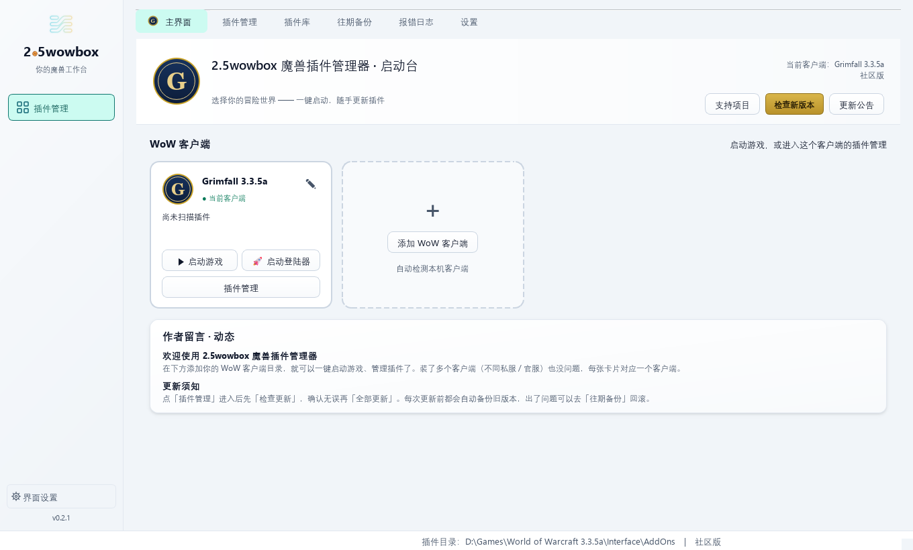
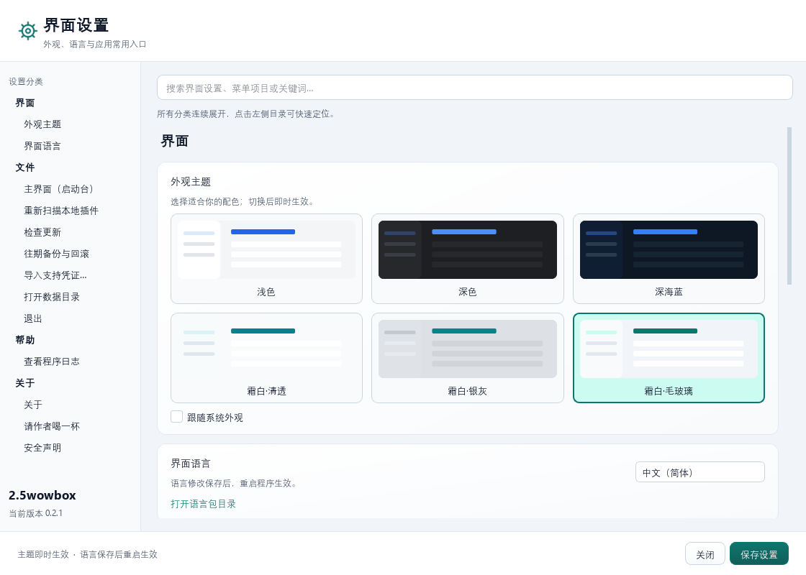
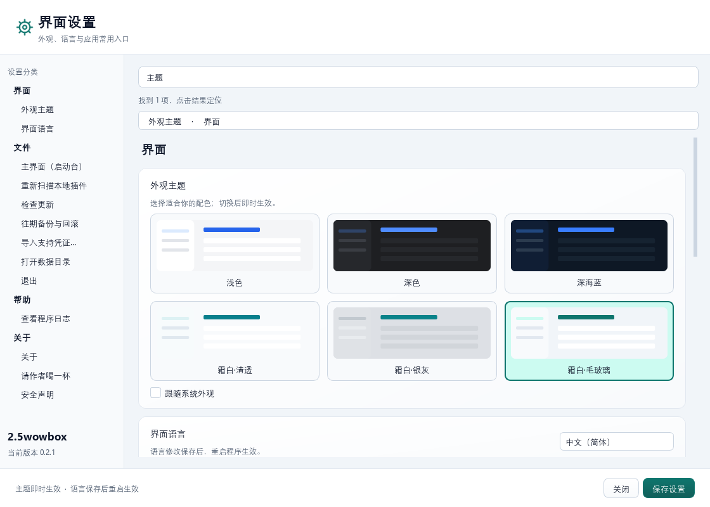
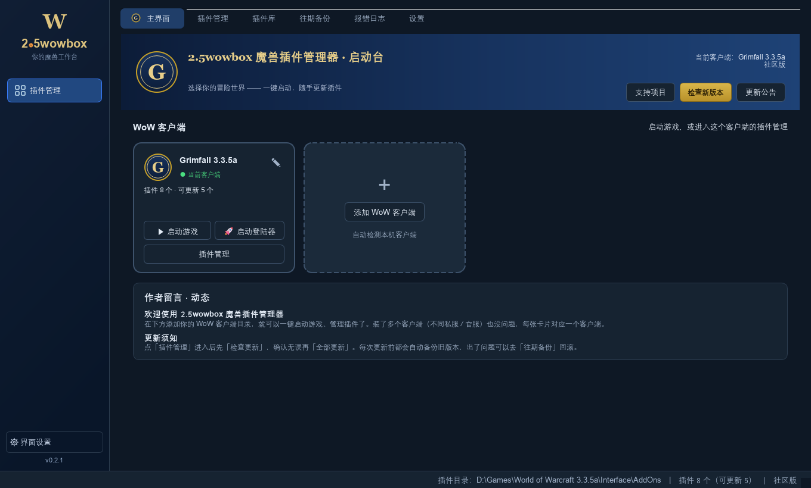
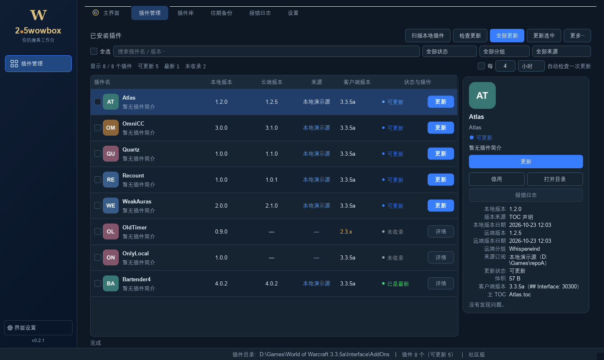
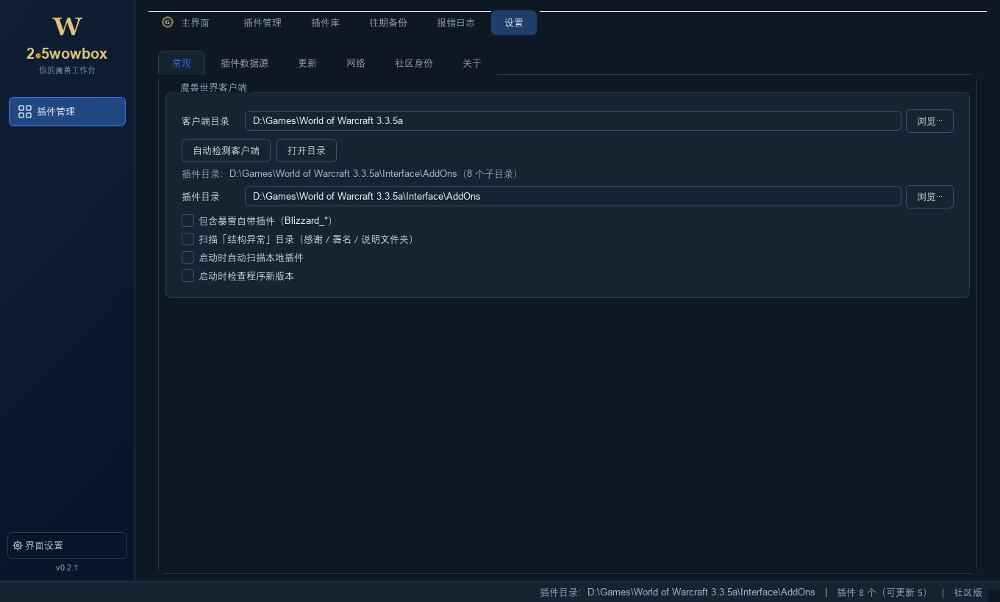
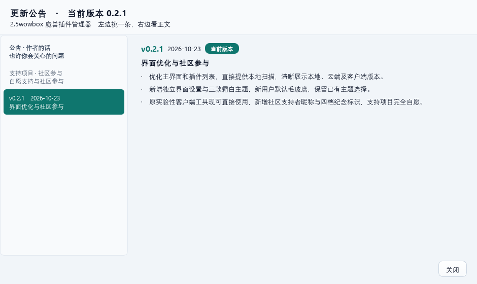

**简体中文**　|　[**English**](README.en.md)

# 2.5wowbox 魔兽插件管理器

**面向各种 WoW 私服的通用插件管理器 —— 不限版本、不限服务器**

一键检查更新 · 自动留存旧版本 · 随时回滚 · 报错日志翻译成人话

[**下载最新版**](../../releases/latest)　·　[使用指南](https://docs.qq.com/sheet/DSHZRZUJ2V2pkQ050?tab=BB08J2)　·　[反馈问题](mailto:kyomunehiro@gmail.com)

---

> **本仓库 `2.5WoWBox` 是《2.5wowbox 魔兽插件管理器》的唯一官方发布渠道。**
> 程序名是「2.5wowbox 魔兽插件管理器」，**英文发布包的文件名统一用 `2.5wowbox-*`**
> （例如 `2.5wowbox-0.1.10.exe`），和程序名一致 —— 方便你确认下到的是不是官方版本。
> 上一个名字是 `SlowLife PlugHub`，2026-10 起改名为 2.5wowbox，**旧文件名的包请不要再下载**。
>
> 本仓库是闭源软件的发布页，不包含源代码。这里放：使用说明、更新内容、以及每个版本的安装包（Releases）。

---

## 这是什么

玩私服的人都遇到过这些麻烦：

- 插件散在十几个网站和网盘里，不知道哪个有新版本；
- 手动替换文件，换错了插件直接报错，还找不回上一天能用的版本；
- 游戏一登录就弹一堆 `Interface\AddOns\xxx\yyy.lua:123: attempt to ...` 红字，看不懂。

**2.5wowbox 魔兽插件管理器**把这三件事收进一个窗口：扫描你本地的 `Interface/AddOns`，
对接你自己的插件源（坚果云 WebDAV / 网盘 / 分享链接 / JSON 清单 / GitHub / 本地目录），
比对版本后一键更新，每次更新前自动备份，出问题随时回滚。

**它的定位是「管理」，不是「整合包」。** 插件用谁的、装哪些，全由你自己决定。

### 0.2.1：界面焕新与主题升级

1. 优化主界面和插件列表，直接提供本地扫描，清晰展示本地、云端及客户端版本。
2. 新增独立界面设置与三款霜白主题，新用户默认毛玻璃，保留已有主题选择。
3. 原实验性客户端工具现可直接使用，新增社区支持者昵称与四档纪念标识，支持项目完全自愿。

0.2.1 已确认版本与更新内容，正在本地打包验收，尚未正式发布。以下是界面使用说明。

左侧是一级功能导航，当前「插件管理」包含主界面、插件管理、插件库、往期备份、报错日志与设置。
其余四个功能位置保留空白，不显示图标、文字或提示；接入具体功能后才启用。窄窗口会收为图标栏。

左栏底部的「界面设置」打开独立窗口。主题、语言、文件、帮助与关于集中在连续长页，
可以上下滚动，也可以通过左侧分类目录或搜索定位。F5、Ctrl+R 等快捷键保留。

「浅色」「深色」「深海蓝」和三款霜白主题均可选择，也可跟随系统。三款霜白统一使用冰蓝至浅金的流线坤标识。
没有已保存或自动迁入的主题偏好时，默认使用「霜白·毛玻璃」；已有主题选择继续保留。
主题即时生效并保存，语言保存后重启生效，支持中英双语和自制语言包。

Windows 11 22H2 及以上、Qt 6.9 及以上可启用原生 Desktop Acrylic，模糊透出桌面与后方窗口。
系统关闭透明效果、失焦或省电时可能使用实色，不支持的平台也会回退为实色。

插件工作区的「设置」继续保留常规、插件数据源、更新、网络、社区身份、关于等分类页签。
主题与语言移到独立「界面设置」，插件配置仍在原位置。

客户端卡片与添加卡片默认等宽等高；悬停或键盘聚焦时展开路径、备注及辅助操作。
名称右侧铅笔按钮用于重命名，启动游戏和插件管理入口始终可见。

---

## 主要功能

| 功能 | 说明 |
| --- | --- |
| **本地扫描** | 识别插件名、版本、客户端接口版本（`3.3.5a` / `1.15.x` / `经典旧世` 等），认出停用的插件 |
| **多客户端** | 一个私服一张卡片，格林服 / 官服 / 测试服各自独立，互不干扰；可随时改名 |
| **多插件源** | 坚果云 WebDAV、常见云盘直链、分享链接、JSON 清单、GitHub、本地文件夹，可同时挂多个 |
| **一键更新** | 按**版本号 + 更新日期**双重判断，不是简单比大小；同名但来源不同的插件标清出处 |
| **自动备份 / 回滚** | 每次覆盖前把旧版本存进「往期备份」，可回滚到任意一次更新之前 |
| **下载对比** | 更新前列出「新增 / 变更 / 缺失」的文件，看清再动手 |
| **报错日志分析** | 扫 `Logs`、`Errors`、`SavedVariables` 三处，把暴雪的错误块翻译成中文并给出处理建议 |
| **启动登陆器** | 除了直接开游戏，还能记住每个私服的登陆器，先用它更新再进游戏 |
| **客户端工具** | 字体替换、补丁管理、个人配置导入导出 |
| **中英双语** | 首次启动按系统语言推荐界面语言，之后可随时在设置里改 |

---

## 界面预览 · 0.2.1

### 插件管理

当前插件列表将图标缩写、名称和简介放在一起，分别展示本地版本、云端版本和对应客户端版本。
顶部直接提供「扫描本地插件」，每行保留单个插件操作，右侧详情集中展示说明、来源、日期及辅助操作。
默认窗口加宽并适配屏幕；窄窗口收起来源，将本地和云端版本合并为标注清楚的两行，保留客户端版本。「更多」中保留备份及可选详细列。

### 插件设置

客户端目录、扫描规则、数据源、更新与网络仍在插件工作区的「设置」中。

### 本次更新公告

更新窗口只显示当前 0.2.1 的三条更新内容，作者公告和支持作者入口独立保留。

全部配图来自 0.2.1 实际 Qt 界面，以隔离的本地演示数据展示。D:\Games 等路径是示例。
这些离屏截图用于展示布局，不代表操作系统的实时桌面模糊效果。

---

## 下载与安装

到 [**Releases**](../../releases/latest) 下载对应压缩包，解压即用，**无需安装、不写注册表**。

| 包 | 适合谁 | 说明 |
| --- | --- | --- |
| `2.5wowbox魔兽插件管理器单EXEv0.2.1.rar` | 大多数用户 | 只有一个 exe，最省事；体积小、拷贝方便 |
| `2.5wowbox魔兽插件管理器解压版1.10.rar` | 怕杀软误报 / 想改配置的 | 一个文件夹，启动更快，**杀软误报率明显更低** |
| `2.5wowbox-0.1.10.exe` | 给不看中文的用户 | 英文命名的单文件版，和上面那个是**同一份程序** |
| `2.5wowbox-0.1.10-portable.zip` | 同上 | 英文命名的文件夹版（zip，Windows 双击即开） |

**首次使用三步：**

1. 解压到任意目录（别放进 `Program Files`，那里默认没有写权限）；
2. 双击 `2.5wowbox魔兽插件管理器.exe`；
3. 首次启动会问你用中文还是 English，然后按界面引导添加客户端目录即可。

**数据放在哪：** 程序同级的 `SlowLifeData/` 文件夹里（配置、缓存、备份、日志全在这儿）。

> 想整个搬到 U 盘带走？直接连 `SlowLifeData/` 一起拷走就行，它就是完整的便携数据。

---

## 社区身份与自愿支持

- 所有功能免费开放，包括插件管理、字体、补丁与个人配置工具，无需导入凭证。
- 默认显示「社区版」；导入作者签发的支持凭证后，显示「社区支持者 · 昵称」。支持也可以来自贡献、翻译和测试，身份不等同付款证明。
- 纪念标识为30天月亮、180天阴影半球、365天全球、长期太阳。到期只让图标变灰，身份保留，不限制功能、不自动弹续期提醒；新凭证会替换昵称与图标。
- 支持完全自愿。也欢迎反馈问题、分享经验、翻译和参与开发。主页提示可关闭，入口随时可手动打开。

请核对软件来源、收款方和服务内容。对第三方收费有疑问时，可联系作者核实。

## 凭证与数据

支持凭证是数据目录中的 `.glic` 文本文件，程序离线核对 Ed25519 签名、产品与设备信息。签名不是加密，昵称和备注对收件人可见。更换设备可能需要重新签发；文件移除后本机身份显示随之移除，全部功能仍可用。

旧自续期凭证会保留；显示支持者身份需导入原作者签发凭证。扫描读取本地插件，更新、恢复及客户端工具会按用户操作写入游戏目录，建议保留备份。可在「界面设置 → 关于 → 安全声明」查看程序说明。

---

## 系统要求

| 项 | 要求 |
| --- | --- |
| 系统 | Windows 10 / 11（64 位） |
| 游戏 | 任意版本 WoW 客户端 / 私服（3.3.5a、1.12、经典旧世等都能用） |
| 权限 | 普通用户权限即可（**不需要管理员**） |
| 网络 | 只有「检查更新 / 拉插件清单」需要联网，其余全离线 |

---

## 常见问题

<b>杀毒软件报毒怎么办？</b>

PyInstaller 打包的 Windows 程序普遍会被误报（因为它的启动方式和某些恶意程序相似）。
把程序目录加入杀软 / Defender 的白名单即可。**解压版比单 EXE 版的误报率低很多**，怕麻烦可以选它。

<b>换电脑了，配置怎么搬？</b>

把整个文件夹（含 `SlowLifeData/`）拷过去即可。数据是纯本地文件，不绑定账号。

<b>怎么彻底卸载？</b>

直接删掉程序文件夹。它不写注册表、不装服务、不留后台进程，删目录就是卸载干净。
个别情况下杀软会占用文件，重启后再删即可。

<b>插件更新后游戏报错了，怎么退回？</b>

打开「往期备份」页，找到那次更新之前的快照，点回滚。每次覆盖前都自动存了一份。

<b>能管理整合包吗？</b>

能识别整合包里的插件，但它不提供「一键安装整套整合包」——这个设计是刻意的：
整合包里往往有大量你不需要的东西，还会互相冲突。用它管理「你自己选的插件」更省心。

<b>支持 Mac / Linux 吗？</b>

目前只发布 Windows 版本。

---

## 支持作者

这个工具是作者用业余时间一点点写出来的。觉得有用的话，**在心里点个赞就够了**——
程序主体只做联网更新，其余全部离线运行，你给好评作者也收不到。

确实想支持的，可以发邮件到 **kyomunehiro@gmail.com**（打赏方式在邮件里答复）。

---

## 声明与免责

- **闭源**：本仓库仅发布编译后的程序与文档，**不提供源代码**。Copyright © Delete，All Rights Reserved。
- **唯一分发渠道**：除本仓库 Releases 外，作者没有授权任何第三方平台（含闲鱼、淘宝等）分发本软件。
  如果你是**付费**从别处拿到这份软件的，请立刻申请退款 —— 那是别人拿免费软件在卖钱。
- **禁止改动后分发**：基于本程序二次打包、修改内置文案或收款方式的版本，均非作者发布，
  作者不对其内容与安全性负责。
- **与暴雪无关**：《魔兽世界》（World of Warcraft）是暴雪娱乐的商标。
  本项目是非官方第三方工具，与 Blizzard Entertainment 没有任何隶属或合作关系。
- **风险自负**：插件来自你自己配置的源，作者不对第三方插件的内容与稳定性负责。
  私自修改本程序造成的一切机器损坏或数据丢失，作者不承担责任。

完整条款（含允许 / 禁止清单、无担保声明）见 **[LICENSE.md](LICENSE.md)**。

---

English readers → **[README.en.md](README.en.md)**

